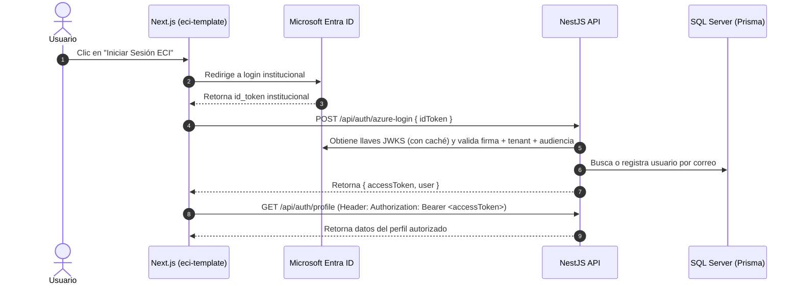

# ECI Backend Template (NestJS + Multi-DB Prisma + Azure AD / JWT)

Plantilla backend robusta para la Escuela Colombiana de Ingeniería Julio Garavito construida con **NestJS 11**, **Prisma ORM multi-base de datos** y autenticación dual **Microsoft Entra ID (Azure AD) + JWT**.

---

## 🚀 Características Principales

1. **Autenticación Dual (Azure AD + JWT)**:
   - Validación criptográfica de `id_token` emitido por Microsoft Entra ID usando las llaves públicas de Microsoft (JWKS con caché en memoria).
   - Verificación de Tenant ID institucional y Client IDs autorizados.
   - Generación de token JWT de sesión para el frontend.
   - Decorador `@Payload()` para extraer claims del usuario autenticado en controladores.
   - Soporte de roles mediante `@Roles('admin', 'docente', 'estudiante')` y `RolesGuard`.
   - Endpoint simulado `/api/auth/dev-login` para pruebas rápidas en local sin depender de Azure en vivo.

2. **Soporte Multi-Base de Datos con Prisma**:
   - Conexión a 1, 2, 3 o más bases de datos de manera modular.
   - **DB-1 (Principal)**: Tablas del sistema (`Usuario`, etc.) usando `DATABASE_URL`.
   - **DB-2 (AppMóvil)**: Dispositivos y notificaciones push usando `DATABASE_URL_APPMOVIL`.
   - **DB-3 (Novasoft)**: Consultas de nómina y empleados usando `DATABASE_URL_NOVASOFT`.
   - Servicios Prisma inyectables independientes (`PrimaryPrismaService`, `AppmovilPrismaService`, `NovasoftPrismaService`).

3. **Arquitectura y Developer Experience**:
   - Documentación interactiva Swagger en `/docs`.
   - Validación automática de DTOs con `class-validator`.
   - Configuración CORS dinámica desde `CORS_ORIGINS`.
   - Cierre limpio de conexiones (`enableShutdownHooks`).

---

## 📦 Instalación y Configuración

### 1. Variables de Entorno

Copia el archivo `.env.example` a `.env.development`:

```bash
cp .env.example .env.development
```

Ajusta los valores:
```env
PORT=3001
NODE_ENV=development
JWT_SECRET=tu_clave_secreta_super_segura
CORS_ORIGINS=http://localhost:3000,http://localhost:3001

AZURE_AD_TENANT_ID=50640584-2a40-4216-a84b-9b3ee0f3f6cf
AZURE_AD_CLIENT_IDS=6e41c1c3-0c43-46b5-8e8b-f6c9b02729d6,86478c0e-05d8-480c-9798-767a09554661

DATABASE_URL="sqlserver://localhost:1433;database=eciciencia_db;user=sa;password=TuPassword;encrypt=true;trustServerCertificate=true"
DATABASE_URL_APPMOVIL="sqlserver://localhost:1433;database=appmovil_db;user=sa;password=TuPassword;encrypt=true;trustServerCertificate=true"
DATABASE_URL_NOVASOFT="sqlserver://localhost:1433;database=novasoft_db;user=sa;password=TuPassword;encrypt=true;trustServerCertificate=true"
```

### 2. Instalar dependencias y generar clientes Prisma

```bash
npm install
npm run prisma:generate
```

### 3. Iniciar el servidor

```bash
# Modo desarrollo con recarga en caliente
npm run start:dev

# Compilar para producción
npm run build
npm run start:prod
```

Visita Swagger en: [http://localhost:3001/docs](http://localhost:3001/docs)

---

## 🔐 Flujo de Autenticación con el Frontend



---

## 🗄️ Estructura del Proyecto

```
src/
├── app.controller.ts
├── app.module.ts
├── app.service.ts
├── main.ts
├── auth/
│   ├── auth.controller.ts       # Endpoints de autenticación
│   ├── auth.guard.ts            # JwtAuthGuard con soporte @Public()
│   ├── auth.module.ts           # Módulo JWT y Passport
│   ├── auth.service.ts          # Generación y verificación de tokens
│   ├── azure-token.service.ts   # Validador nativo de id_token de Azure AD
│   ├── JwtStrategy.ts           # Estrategia Passport JWT Bearer
│   ├── payload.decorator.ts     # Decorador @Payload()
│   ├── roles.decorator.ts       # Decorador @Roles()
│   ├── roles.guard.ts           # Guard de autorización por rol
│   └── dto/
├── database/
│   ├── primary-prisma.service.ts   # Conexión DB-1
│   ├── appmovil-prisma.service.ts  # Conexión DB-2
│   ├── novasoft-prisma.service.ts  # Conexión DB-3
│   └── database.module.ts          # Módulo global exportado
└── users/
    ├── users.controller.ts
    ├── users.module.ts
    └── users.service.ts
```
